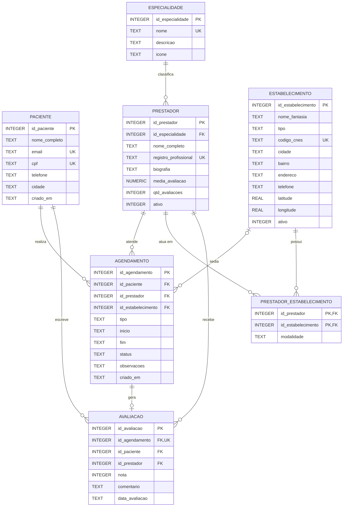

# Modelo ER do banco de dados local

[← Voltar ao índice](../README.md)

**Banco de dados:** SQLite 3, embarcado no aplicativo, com arquivo `saude_serra.db` armazenado no diretório privado do app.

> **Nota sobre tipagem.** O SQLite utiliza afinidades de tipos. Neste modelo, são usados `INTEGER`, `TEXT`, `REAL` e `NUMERIC`. Datas e horários são armazenados como `TEXT` em formato consistente `YYYY-MM-DD HH:MM:SS`; valores lógicos são representados por `INTEGER` (`0` ou `1`). O formato de datas indicado é uma representação textual compatível com as funções de data e hora do SQLite, sem informação de fuso horário. O aplicativo deve adotar uma convenção de fuso consistente.
>
> **Integridade referencial.** A aplicação deve habilitar `PRAGMA foreign_keys = ON` em cada conexão SQLite para aplicar as restrições de chave estrangeira e suas ações de exclusão.

---

## Diagrama entidade-relacionamento

> **Leitura das cardinalidades:** um agendamento deve ter exatamente um paciente e um prestador; pode ter zero ou um estabelecimento (por exemplo, em teleconsulta). Um agendamento pode gerar no máximo uma avaliação. A associação entre prestadores e estabelecimentos é N:N, resolvida pela tabela intermediária.

---

## Detalhamento das tabelas

### `paciente` — usuário do aplicativo

| Coluna | Tipo | Restrição |
|---|---|---|
| `id_paciente` | INTEGER | PK, AUTOINCREMENT |
| `nome_completo` | TEXT | NOT NULL |
| `email` | TEXT | NOT NULL, UNIQUE |
| `cpf` | TEXT | UNIQUE |
| `telefone` | TEXT | — |
| `cidade` | TEXT | — |
| `criado_em` | TEXT | NOT NULL, DEFAULT `datetime('now','localtime')` |

### `especialidade` — especialidades médicas

| Coluna | Tipo | Restrição |
|---|---|---|
| `id_especialidade` | INTEGER | PK, AUTOINCREMENT |
| `nome` | TEXT | NOT NULL, UNIQUE |
| `descricao` | TEXT | — |
| `icone` | TEXT | — |

### `estabelecimento` — clínicas, hospitais e laboratórios

| Coluna | Tipo | Restrição |
|---|---|---|
| `id_estabelecimento` | INTEGER | PK, AUTOINCREMENT |
| `nome_fantasia` | TEXT | NOT NULL |
| `tipo` | TEXT | NOT NULL, CHECK (`tipo` IN ('clinica','hospital','laboratorio','consultorio')) |
| `codigo_cnes` | TEXT | UNIQUE |
| `cidade` | TEXT | NOT NULL |
| `bairro` | TEXT | — |
| `endereco` | TEXT | — |
| `telefone` | TEXT | — |
| `latitude` | REAL | — |
| `longitude` | REAL | — |
| `ativo` | INTEGER | NOT NULL, DEFAULT 1, CHECK (`ativo` IN (0,1)) |

### `prestador` — profissionais de saúde

| Coluna | Tipo | Restrição |
|---|---|---|
| `id_prestador` | INTEGER | PK, AUTOINCREMENT |
| `id_especialidade` | INTEGER | NOT NULL, FK → `especialidade(id_especialidade)` ON DELETE RESTRICT |
| `nome_completo` | TEXT | NOT NULL |
| `registro_profissional` | TEXT | UNIQUE |
| `biografia` | TEXT | — |
| `media_avaliacao` | NUMERIC | DEFAULT 0, CHECK (`media_avaliacao` BETWEEN 0 AND 5) |
| `qtd_avaliacoes` | INTEGER | NOT NULL, DEFAULT 0 |
| `ativo` | INTEGER | NOT NULL, DEFAULT 1, CHECK (`ativo` IN (0,1)) |

### `prestador_estabelecimento` — tabela associativa (N:N)

Um profissional pode atender em vários estabelecimentos, e um estabelecimento pode reunir vários profissionais.

| Coluna | Tipo | Restrição |
|---|---|---|
| `id_prestador` | INTEGER | PK composta, FK → `prestador(id_prestador)` ON DELETE CASCADE |
| `id_estabelecimento` | INTEGER | PK composta, FK → `estabelecimento(id_estabelecimento)` ON DELETE CASCADE |
| `modalidade` | TEXT | NOT NULL, DEFAULT 'presencial', CHECK (`modalidade` IN ('presencial','teleconsulta')) |

**Chave primária composta:** (`id_prestador`, `id_estabelecimento`), impedindo duplicar o mesmo vínculo.

### `agendamento` — consultas e exames marcados

| Coluna | Tipo | Restrição |
|---|---|---|
| `id_agendamento` | INTEGER | PK, AUTOINCREMENT |
| `id_paciente` | INTEGER | NOT NULL, FK → `paciente(id_paciente)` ON DELETE CASCADE |
| `id_prestador` | INTEGER | NOT NULL, FK → `prestador(id_prestador)` ON DELETE RESTRICT |
| `id_estabelecimento` | INTEGER | FK → `estabelecimento(id_estabelecimento)` ON DELETE SET NULL |
| `tipo` | TEXT | NOT NULL, CHECK (`tipo` IN ('consulta','exame')) |
| `inicio` | TEXT | NOT NULL (data/hora em formato consistente) |
| `fim` | TEXT | NOT NULL, CHECK (`fim` > `inicio`) |
| `status` | TEXT | NOT NULL, DEFAULT 'agendado', CHECK (`status` IN ('agendado','realizado','cancelado','faltou')) |
| `observacoes` | TEXT | — |
| `criado_em` | TEXT | NOT NULL, DEFAULT `datetime('now','localtime')` |

**Restrição adicional:** `UNIQUE (id_prestador, inicio)` impede dois agendamentos do mesmo profissional com horário inicial idêntico. Essa restrição, isoladamente, **não impede sobreposição de intervalos**; isso requer validação adicional.

### `avaliacao` — notas e comentários

| Coluna | Tipo | Restrição |
|---|---|---|
| `id_avaliacao` | INTEGER | PK, AUTOINCREMENT |
| `id_agendamento` | INTEGER | NOT NULL, UNIQUE, FK → `agendamento(id_agendamento)` ON DELETE CASCADE |
| `id_paciente` | INTEGER | NOT NULL, FK → `paciente(id_paciente)` ON DELETE CASCADE |
| `id_prestador` | INTEGER | NOT NULL, FK → `prestador(id_prestador)` ON DELETE CASCADE |
| `nota` | INTEGER | NOT NULL, CHECK (`nota` BETWEEN 1 AND 5) |
| `comentario` | TEXT | — |
| `data_avaliacao` | TEXT | NOT NULL, DEFAULT `datetime('now','localtime')` |

O campo `id_agendamento` é único para limitar cada atendimento a, no máximo, uma avaliação. Os campos `id_paciente` e `id_prestador` repetem informações disponíveis no agendamento e devem ser mantidos consistentes com ele.

---

## Resumo dos relacionamentos

| Relacionamento | Cardinalidade | Regra de negócio |
|---|---|---|
| `especialidade` → `prestador` | 1 : N | Todo prestador possui exatamente uma especialidade principal |
| `prestador` → `prestador_estabelecimento` | 1 : N | Um prestador pode possuir vários vínculos com estabelecimentos |
| `estabelecimento` → `prestador_estabelecimento` | 1 : N | Um estabelecimento pode possuir vários prestadores vinculados |
| `prestador` ↔ `estabelecimento` | N : N | Relacionamento derivado da tabela associativa |
| `paciente` → `agendamento` | 1 : N | Um paciente pode realizar vários agendamentos |
| `prestador` → `agendamento` | 1 : N | Um prestador pode atender vários agendamentos |
| `estabelecimento` → `agendamento` | 0..1 : N | Cada agendamento pode ter zero ou um estabelecimento; um estabelecimento pode sediar vários agendamentos |
| `agendamento` → `avaliacao` | 1 : 0..1 | Cada agendamento admite no máximo uma avaliação |
| `paciente` → `avaliacao` | 1 : N | Um paciente pode escrever várias avaliações |
| `prestador` → `avaliacao` | 1 : N | Um prestador pode receber várias avaliações |

Há **9 referências por chave estrangeira** (sem contar o relacionamento N:N derivado): 1 em `prestador`, 2 em `prestador_estabelecimento`, 3 em `agendamento` e 3 em `avaliacao`.

---

## Regras de negócio e validações adicionais

As regras abaixo complementam as restrições declaradas nas tabelas. **Sua descrição não significa que já estejam implementadas**: devem ser verificadas no código do aplicativo ou implementadas por mecanismos apropriados no banco.

1. **Vínculo entre profissional e estabelecimento.** Quando `id_estabelecimento` estiver preenchido em um agendamento, o par (`id_prestador`, `id_estabelecimento`) deve existir em `prestador_estabelecimento`. Como as colunas são mantidas separadamente e o estabelecimento pode ser nulo, o modelo atual não garante essa regra somente com as FKs individuais.
2. **Modalidade de atendimento.** O campo `modalidade` da tabela associativa descreve o vínculo do prestador com um estabelecimento. O modelo atual não possui uma coluna específica de modalidade em `agendamento`. Portanto, a distinção entre atendimento presencial e teleconsulta e a obrigatoriedade do local físico devem ser validadas por regras do aplicativo. A ausência de estabelecimento não deve, por si só, ser considerada prova de teleconsulta.
3. **Conflito de horários.** Para um mesmo prestador, não devem existir agendamentos ativos com intervalos sobrepostos. Para intervalos semiabertos, existe conflito quando `novo_inicio < fim_existente` e `novo_fim > inicio_existente`. A política de quais status bloqueiam a agenda deve ser definida pelo grupo; agendamentos cancelados normalmente não bloqueiam horários.
4. **Avaliações válidas.** Uma avaliação deve ser permitida apenas para um agendamento com status `realizado`. `id_paciente` e `id_prestador` da avaliação devem corresponder aos do agendamento relacionado. Essa consistência não é garantida pelas FKs individuais.
5. **Médias de avaliações.** `media_avaliacao` e `qtd_avaliacoes` em `prestador` são valores derivados das avaliações. Devem ser recalculados ou atualizados de modo consistente quando avaliações forem inseridas, alteradas ou excluídas. Recomenda-se também validar que `qtd_avaliacoes >= 0`.
6. **Formato e comparação de datas.** A comparação textual de `fim > inicio` funciona cronologicamente somente se todos os horários forem armazenados em um formato padronizado e com a mesma convenção de fuso. É necessário validar o formato e a existência real das datas na aplicação.
7. **Exclusões e histórico.** As ações `ON DELETE CASCADE`, `RESTRICT` e `SET NULL` estão documentadas nas tabelas. Antes de excluir registros de pacientes, estabelecimentos ou avaliações, o grupo deve considerar a necessidade de preservar o histórico de atendimentos e avaliações.

---

**Atendimento aos requisitos da Etapa 1:** o modelo contém **7 tabelas** (mínimo de 4), todas com **3 ou mais colunas**, e **9 referências por chave estrangeira** entre tabelas (mínimo de uma relação entre duas tabelas). Apresenta também os tipos de dados, chaves, restrições, cardinalidades e regras de negócio solicitados.
