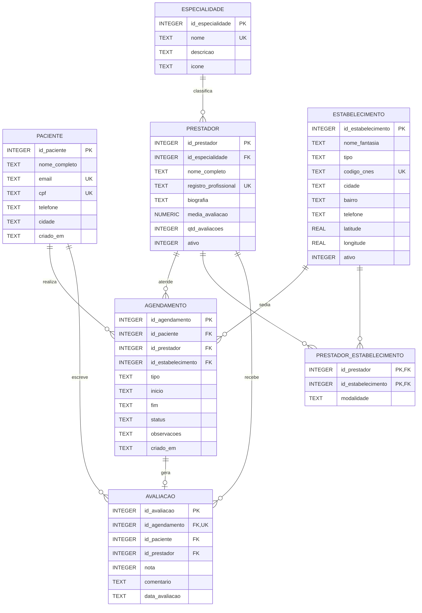

# Modelo ER do banco de dados local

[← Voltar ao índice](../README.md)

Banco: **SQLite 3**, embarcado no aplicativo, arquivo `saude_serra.db` no diretório privado do app.

> **Nota sobre tipagem.** O SQLite trabalha com afinidade de tipos, e não com tipos rígidos. Não existem `UUID`, `TIMESTAMPTZ`, `BOOLEAN` ou `VARCHAR(n)` com validação de tamanho. O modelo abaixo já está expresso nos tipos reais do SQLite: `INTEGER`, `TEXT`, `REAL` e `NUMERIC`. Datas são gravadas como `TEXT` no formato ISO-8601 (`YYYY-MM-DD HH:MM:SS`) e valores lógicos como `INTEGER` 0/1, que são as convenções recomendadas pela própria documentação do SQLite.

---

## Diagrama entidade-relacionamento

---

## Detalhamento das tabelas

### `paciente` — usuário do aplicativo

| Coluna | Tipo | Restrição |
|---|---|---|
| `id_paciente` | INTEGER | PK, AUTOINCREMENT |
| `nome_completo` | TEXT | NOT NULL |
| `email` | TEXT | NOT NULL, UNIQUE |
| `cpf` | TEXT | UNIQUE |
| `telefone` | TEXT | — |
| `cidade` | TEXT | — |
| `criado_em` | TEXT | NOT NULL, DEFAULT `datetime('now','localtime')` |

---

### `especialidade` — especialidades médicas

| Coluna | Tipo | Restrição |
|---|---|---|
| `id_especialidade` | INTEGER | PK, AUTOINCREMENT |
| `nome` | TEXT | NOT NULL, UNIQUE |
| `descricao` | TEXT | — |
| `icone` | TEXT | — |

---

### `estabelecimento` — clínicas, hospitais e laboratórios

| Coluna | Tipo | Restrição |
|---|---|---|
| `id_estabelecimento` | INTEGER | PK, AUTOINCREMENT |
| `nome_fantasia` | TEXT | NOT NULL |
| `tipo` | TEXT | NOT NULL, CHECK IN ('clinica','hospital','laboratorio','consultorio') |
| `codigo_cnes` | TEXT | UNIQUE |
| `cidade` | TEXT | NOT NULL |
| `bairro` | TEXT | — |
| `endereco` | TEXT | — |
| `telefone` | TEXT | — |
| `latitude` | REAL | — |
| `longitude` | REAL | — |
| `ativo` | INTEGER | NOT NULL, DEFAULT 1, CHECK IN (0,1) |

---

### `prestador` — profissionais de saúde

| Coluna | Tipo | Restrição |
|---|---|---|
| `id_prestador` | INTEGER | PK, AUTOINCREMENT |
| `id_especialidade` | INTEGER | NOT NULL, FK → `especialidade(id_especialidade)` ON DELETE RESTRICT |
| `nome_completo` | TEXT | NOT NULL |
| `registro_profissional` | TEXT | UNIQUE |
| `biografia` | TEXT | — |
| `media_avaliacao` | NUMERIC | DEFAULT 0, CHECK BETWEEN 0 AND 5 |
| `qtd_avaliacoes` | INTEGER | NOT NULL, DEFAULT 0 |
| `ativo` | INTEGER | NOT NULL, DEFAULT 1, CHECK IN (0,1) |

---

### `prestador_estabelecimento` — tabela associativa (N:N)

Um profissional pode atender em vários locais e um local reúne vários profissionais.

| Coluna | Tipo | Restrição |
|---|---|---|
| `id_prestador` | INTEGER | PK composta, FK → `prestador(id_prestador)` ON DELETE CASCADE |
| `id_estabelecimento` | INTEGER | PK composta, FK → `estabelecimento(id_estabelecimento)` ON DELETE CASCADE |
| `modalidade` | TEXT | NOT NULL, DEFAULT 'presencial', CHECK IN ('presencial','teleconsulta') |

---

### `agendamento` — consultas e exames marcados

| Coluna | Tipo | Restrição |
|---|---|---|
| `id_agendamento` | INTEGER | PK, AUTOINCREMENT |
| `id_paciente` | INTEGER | NOT NULL, FK → `paciente(id_paciente)` ON DELETE CASCADE |
| `id_prestador` | INTEGER | NOT NULL, FK → `prestador(id_prestador)` ON DELETE RESTRICT |
| `id_estabelecimento` | INTEGER | FK → `estabelecimento(id_estabelecimento)` ON DELETE SET NULL |
| `tipo` | TEXT | NOT NULL, CHECK IN ('consulta','exame') |
| `inicio` | TEXT | NOT NULL (ISO-8601) |
| `fim` | TEXT | NOT NULL, CHECK (`fim` > `inicio`) |
| `status` | TEXT | NOT NULL, DEFAULT 'agendado', CHECK IN ('agendado','realizado','cancelado','faltou') |
| `observacoes` | TEXT | — |
| `criado_em` | TEXT | NOT NULL, DEFAULT `datetime('now','localtime')` |

Restrição adicional: `UNIQUE (id_prestador, inicio)` — impede reservar o mesmo horário duas vezes para o mesmo profissional.

---

### `avaliacao` — notas e comentários

| Coluna | Tipo | Restrição |
|---|---|---|
| `id_avaliacao` | INTEGER | PK, AUTOINCREMENT |
| `id_agendamento` | INTEGER | NOT NULL, UNIQUE, FK → `agendamento(id_agendamento)` ON DELETE CASCADE |
| `id_paciente` | INTEGER | NOT NULL, FK → `paciente(id_paciente)` ON DELETE CASCADE |
| `id_prestador` | INTEGER | NOT NULL, FK → `prestador(id_prestador)` ON DELETE CASCADE |
| `nota` | INTEGER | NOT NULL, CHECK BETWEEN 1 AND 5 |
| `comentario` | TEXT | — |
| `data_avaliacao` | TEXT | NOT NULL, DEFAULT `datetime('now','localtime')` |

---

## Resumo dos relacionamentos

| Relacionamento | Cardinalidade | Regra de negócio |
|---|---|---|
| `especialidade` → `prestador` | 1 : N | Todo prestador tem exatamente uma especialidade principal |
| `prestador` ↔ `estabelecimento` | N : N | Resolvido por `prestador_estabelecimento` |
| `paciente` → `agendamento` | 1 : N | Um paciente pode ter vários agendamentos |
| `prestador` → `agendamento` | 1 : N | Um prestador atende vários agendamentos |
| `estabelecimento` → `agendamento` | 1 : N | Opcional; teleconsulta não tem local físico |
| `agendamento` → `avaliacao` | 1 : 0..1 | Cada atendimento admite no máximo uma avaliação |

**Atendimento aos requisitos da Etapa 1:** 7 tabelas (mínimo 4), todas com 3 ou mais colunas (a menor tem 3), e 8 relacionamentos por chave estrangeira entre tabelas (mínimo 1).
