# Wireframes das telas

[← Voltar ao índice](../README.md)

Protótipos de alta definição das telas do aplicativo **+ Saúde Serra**. As imagens em tamanho original estão em [`docs/wireframes/`](wireframes/).

---

## 1. Guia Médico — busca de estabelecimentos (HU01)

<table>
<tr>
<td align="center" width="25%">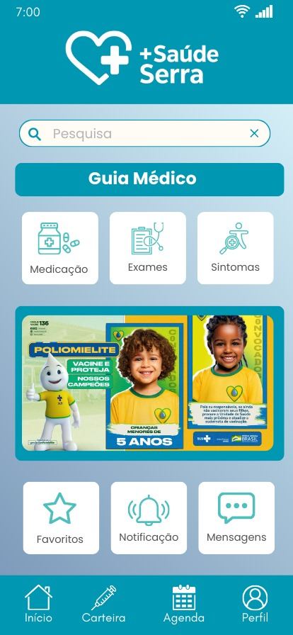 <b>01.</b> Tela inicial</td>
<td align="center" width="25%">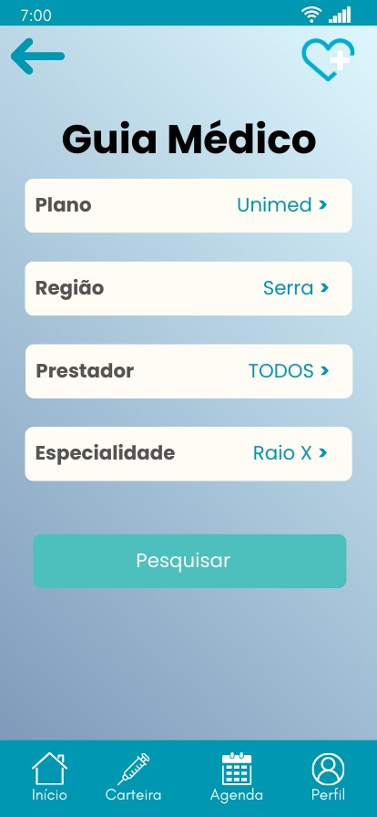 <b>02.</b> Filtro de busca</td>
<td align="center" width="25%">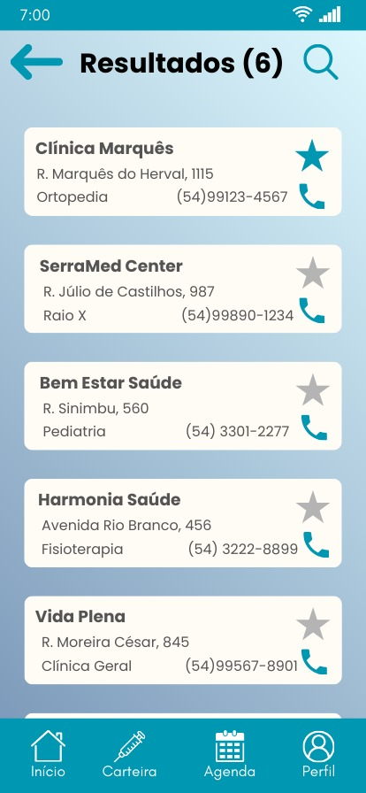 <b>03.</b> Resultados</td>
<td align="center" width="25%">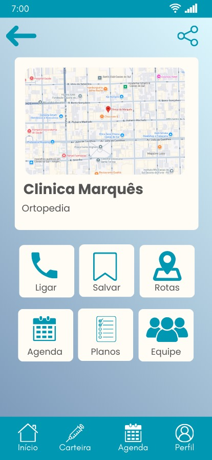 <b>04.</b> Detalhes da clínica</td>
</tr>
</table>

| Tela | Descrição | Dados lidos do SQLite |
|---|---|---|
| **01. Tela inicial** | Busca geral, atalho para o Guia Médico, acessos rápidos (Medicação, Exames, Sintomas), banner informativo e acessos a Favoritos, Notificações e Mensagens. Navegação inferior fixa: Início, Carteira, Agenda e Perfil. | `agendamento` (próximas consultas) |
| **02. Filtro de busca** | Seleção encadeada de Plano, Região, Prestador e Especialidade antes de pesquisar. | `especialidade`, `estabelecimento` |
| **03. Resultados** | Lista de estabelecimentos com nome, endereço, especialidade e telefone. A estrela marca favoritos e o ícone de telefone inicia a ligação. | `estabelecimento`, `prestador_estabelecimento` |
| **04. Detalhes da clínica** | Mapa da localização, nome e especialidade, com ações: Ligar, Salvar, Rotas, Agenda, Planos e Equipe. | `estabelecimento`, `prestador` |

---

## 2. Especialidades (HU02)

<table>
<tr>
<td align="center" width="25%">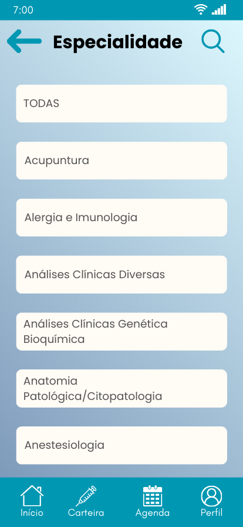 <b>05.</b> Lista de especialidades</td>
<td align="center" width="25%"> <b>06.</b> Prestadores da especialidade</td>
<td width="50%"></td>
</tr>
</table>

| Tela | Descrição | Dados lidos do SQLite |
|---|---|---|
| **05. Lista de especialidades** | Catálogo completo em ordem alfabética, com opção "TODAS" e busca por texto no topo. | `especialidade` |
| **06. Prestadores da especialidade** | Reaproveita o mesmo componente de resultados, filtrado pela especialidade escolhida. | `prestador`, `especialidade`, `estabelecimento` |

---

## 3. Agendamento (HU03)

<table>
<tr>
<td align="center" width="33%">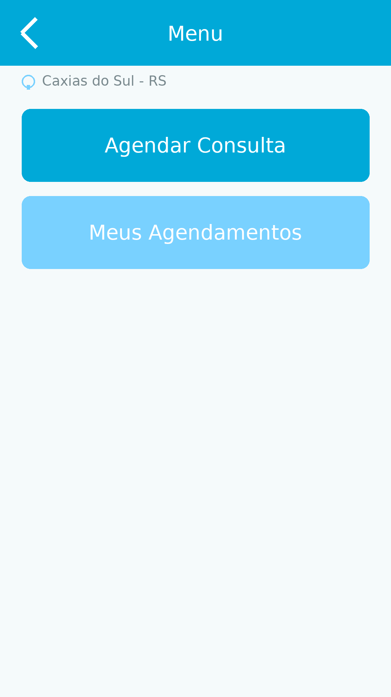 <b>07.</b> Menu de agendamento</td>
<td align="center" width="33%"> <b>08.</b> Selecionar médico</td>
<td align="center" width="33%">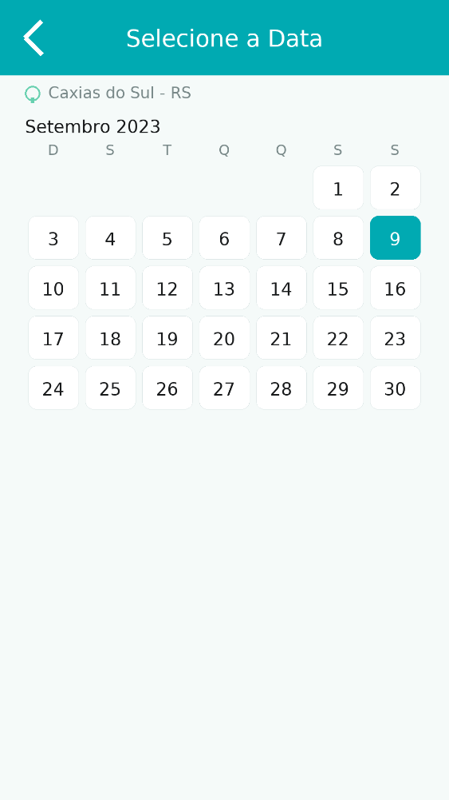 <b>09.</b> Selecionar data</td>
</tr>
<tr>
<td align="center">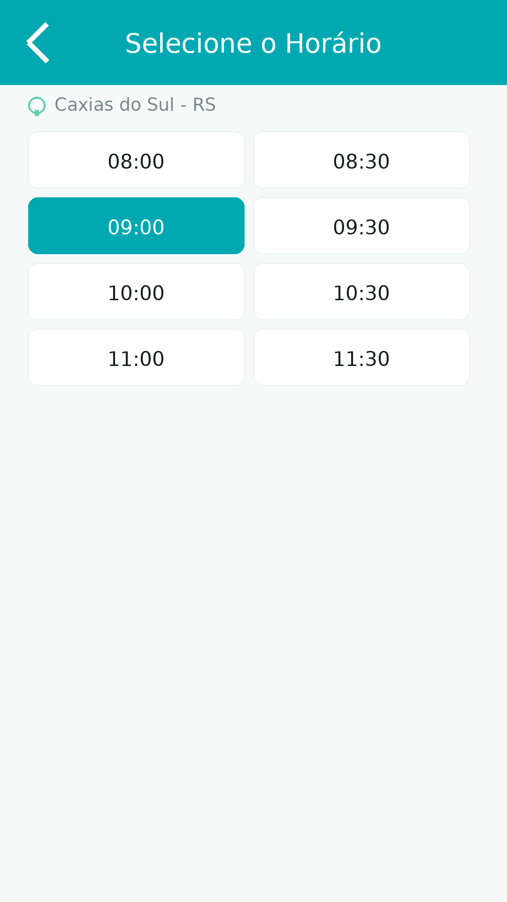 <b>10.</b> Selecionar horário</td>
<td align="center"> <b>11.</b> Confirmar agendamento</td>
<td align="center">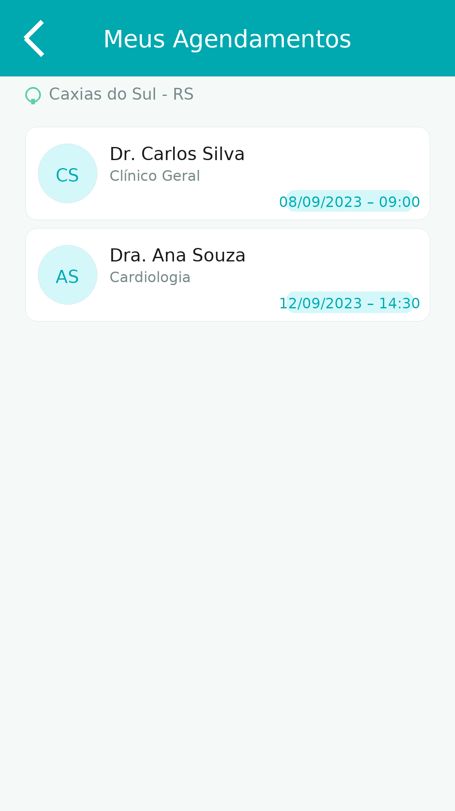 <b>12.</b> Meus agendamentos</td>
</tr>
</table>

| Tela | Descrição | Operação no SQLite |
|---|---|---|
| **07. Menu de agendamento** | Ponto de entrada com "Agendar Consulta" e "Meus Agendamentos", já contextualizado pela cidade. | — |
| **08. Selecionar médico** | Lista de profissionais com avatar de iniciais, nome e especialidade. | `SELECT` em `prestador` + `especialidade` |
| **09. Selecionar data** | Calendário mensal com a data escolhida destacada. | `SELECT` de datas com horário livre |
| **10. Selecionar horário** | Grade de horários em intervalos de 30 minutos; o horário escolhido fica destacado. | `SELECT` de horários livres do prestador |
| **11. Confirmar agendamento** | Resumo com médico, data, horário e cidade, e botão de confirmação. | `INSERT` em `agendamento` (em transação) |
| **12. Meus agendamentos** | Agendamentos do usuário com profissional, especialidade, data e hora. | `SELECT` por `id_paciente`, ordenado por `inicio` |

---

## 4. Modelos comportamental e estrutural

Diagramas UML elaborados para a história de agendamento, disponíveis em [`docs/diagramas/`](diagramas/).

<table>
<tr>
<td align="center" width="50%">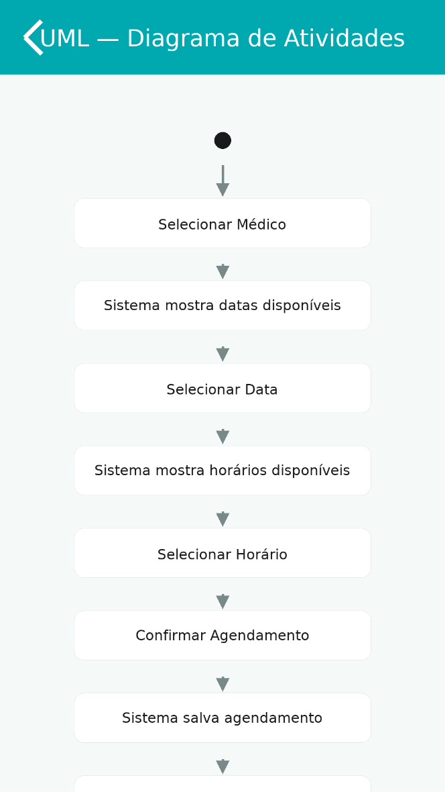 <b>Diagrama de atividades</b> — fluxo do agendamento</td>
<td align="center" width="50%">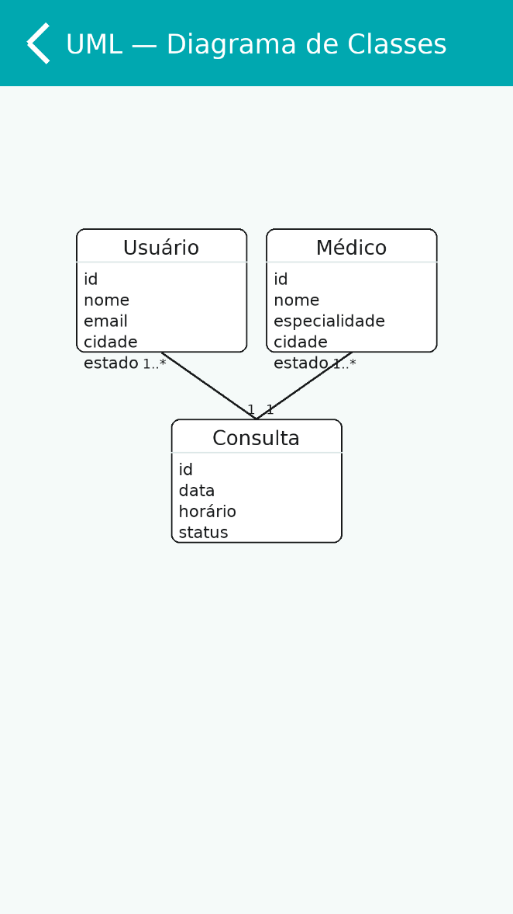 <b>Diagrama de classes</b> — Usuário, Médico e Consulta</td>
</tr>
</table>

> O diagrama de classes acima é a visão conceitual herdada do Projeto Integrador IV-A. A modelagem física completa, já adaptada ao SQLite, está em [Modelo ER](02-modelo-er.md).

---

## 5. Mapa de navegação

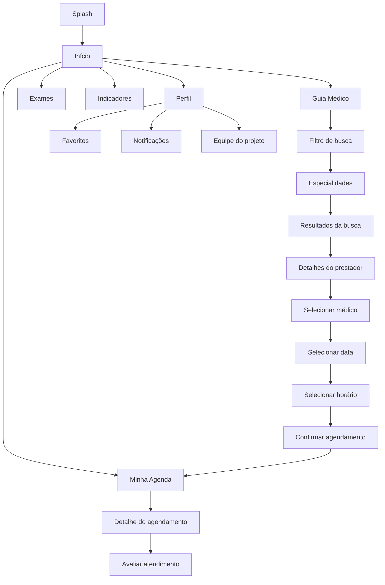

---

## 6. Telas a serem desenhadas no VI-B

As telas acima vêm do protótipo validado no Projeto Integrador IV-A. Os requisitos novos desta etapa exigem cinco telas adicionais:

| Tela | Finalidade | História |
|---|---|---|
| Avaliar atendimento | Nota de 1 a 5 e comentário, liberados após a data da consulta | HU04 |
| Painel de indicadores | Gráficos gerados a partir das consultas de agregação no banco local | HU05 |
| Equipe do projeto | Nome completo dos integrantes do grupo | Requisito da disciplina |
| Exames | Acompanhamento do status dos exames solicitados | F07 |
| Favoritos | Prestadores e estabelecimentos marcados | F09 |

---

## 7. Padrões de design adotados

- **Paleta:** azul-petróleo (`#0E9AA7`) como cor primária, fundo claro em degradê, cards em branco-creme; verde para confirmações e vermelho para cancelamentos.
- **Tipografia:** família única em três tamanhos (título, corpo e legenda), com títulos em peso bold para favorecer a leitura do público de maior faixa etária.
- **Área de toque:** alvos de no mínimo 48 × 48 dp, conforme o Material Design.
- **Navegação:** barra inferior fixa com quatro destinos (Início, Carteira, Agenda, Perfil) e seta de retorno no topo das telas internas.
- **Estados da tela:** cada listagem tem três estados desenhados — carregando, com conteúdo e vazio.
- **Indicador de offline:** faixa discreta informando que os dados exibidos vêm do banco local e permanecem utilizáveis sem conexão.
- **Tema claro e escuro:** suportados pelo `userInterfaceStyle: "automatic"` já configurado no `app.json`.

---

## 8. Observações sobre o protótipo

1. **Duas linguagens visuais.** As telas 01 a 05 estão no padrão visual final, com a identidade "+ Saúde Serra". As telas 07 a 12 vêm de um protótipo funcional anterior, mais simples, sem a barra de navegação inferior e sem a identidade aplicada. Antes da entrega vale uniformizar o fluxo de agendamento no padrão das primeiras telas.
2. **Dados de exemplo.** Nomes de médicos, clínicas e as datas de setembro de 2023 que aparecem nas imagens são fictícios, usados apenas para ilustrar o protótipo.
3. **Protótipo navegável.** Recomenda-se publicar a versão final no [Figma](https://www.figma.com/) e incluir o link aqui, para que o avaliador possa percorrer o fluxo.
